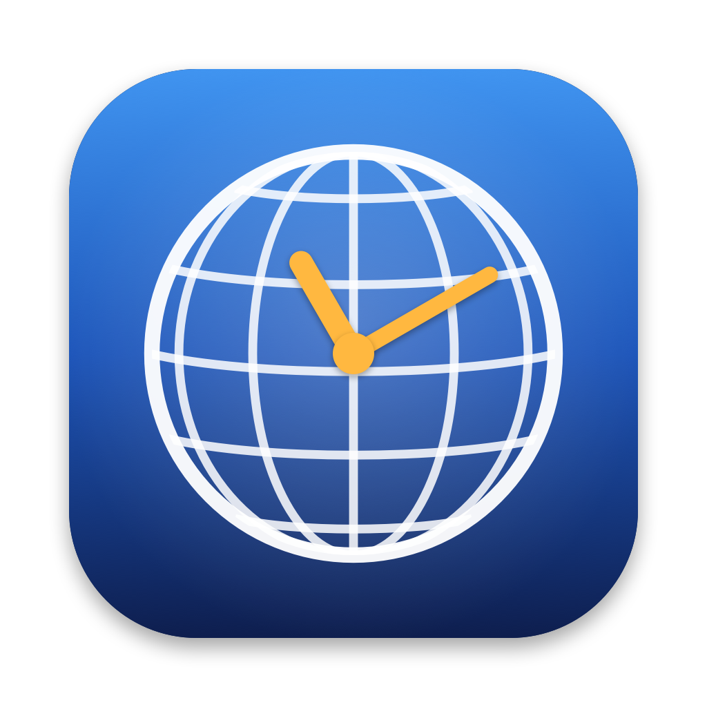
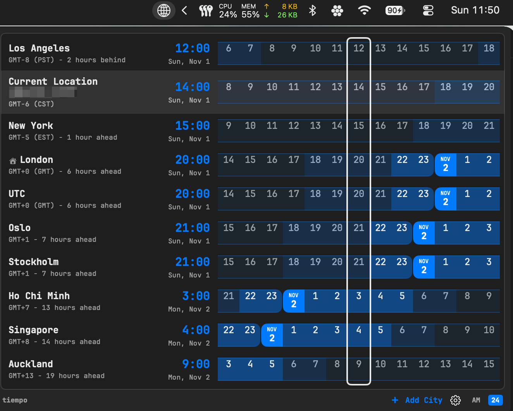

<p align="center"></p>

<h1 align="center">tiempo</h1>

<p align="center">A world clock that lives in your Mac's menu bar.</p>

Click the globe in the menu bar to see every city you care about side by side, each with a colored strip of hours so you can find a meeting time at a glance.

<p align="center"></p>

## Features

- **One row per city:** name, GMT offset, how many hours ahead or behind your current location it is, live time and date.
- **Current Location:** your own time zone is always available as "Current Location (City)", highlighted in gray.
- **Hour strip:** the hours around now for every city, lined up so each column is the same moment. Night is darkest, then morning and evening, then day, and midnight shows the new date. Hover or click a column to see every city's time at that hour; **Now** returns to live time.
- **Home city:** the house icon marks the city whose hours the strip lines up with. Right-click any city to make it home.
- **Sorting:** drag a city by its name to reorder, or sort by time zone (west to east or east to west) from the gear menu.
- **Add any city:** **+ Add City** searches every time zone on your Mac by city, region, zone name or abbreviation (e.g. Tokyo, PST).
- **Fits macOS:** uses your accent color and follows light and dark mode, or pick Light or Dark yourself.
- **Fonts:** JetBrains Mono (if [installed](https://www.jetbrains.com/lp/mono/)), SF Mono, SF Pro, SF Pro Rounded, New York or Menlo.
- **Gear menu:** font, appearance, 12- or 24-hour time, hours shown (5 to 24), a city's time next to the globe in the menu bar, launch at login.

No network access, accounts or tracking: times come from the time zone data built into macOS, so daylight saving changes are handled automatically.

## Requirements

A Mac with Apple silicon (M1 or later) running macOS 14 Sonoma or later.

## Install

1. Download `tiempo-<version>.zip` from the [latest release](https://github.com/blackboxprojects/tiempo/releases/latest).
2. Unzip it and drag **tiempo** into your **Applications** folder.
3. Open tiempo. The globe appears in your menu bar.

**First launch:** tiempo isn't notarized by Apple, so macOS blocks it the first time. Open **System Settings → Privacy & Security**, scroll down to the message about tiempo, click **Open Anyway**, and confirm. You only do this once. If you prefer Terminal, this does the same:

```bash
xattr -dr com.apple.quarantine /Applications/tiempo.app
```

To start tiempo when you log in, turn on **Launch at Login** from the gear menu.

## Build from source

Requires Xcode or the Xcode command-line tools.

```bash
./build.sh
open build/tiempo.app
```

Copy `build/tiempo.app` to `/Applications` to keep it.

## Make a release

```bash
./scripts/release.sh
```

This builds the app and packages it as `build/tiempo-<version>.zip` (the version comes from `CFBundleShortVersionString` in `Info.plist`). On GitHub, open **Releases → Draft a new release**, create a tag such as `v1.0`, attach the zip, and publish.

## App icon

The icon is drawn by `scripts/make-icon.swift`. To change it, edit that file and run:

```bash
./scripts/make-icon.sh
```

## Project layout

| Path | What it holds |
| --- | --- |
| `Sources/tiempo/App.swift` | App entry point and the menu bar globe |
| `Sources/tiempo/ClockStore.swift` | Cities, settings, sorting and the hour strip timing |
| `Sources/tiempo/ClockPanel.swift` | The panel: city rows, hour strip, drag to reorder, bottom bar |
| `Sources/tiempo/Clock.swift` | Time, date and offset formatting; colors and fonts |
| `Sources/tiempo/CitySearch.swift` | The Add City search |

## Support

If tiempo saves you a time zone headache, you can buy me a coffee:

<a href="https://www.buymeacoffee.com/blackboxlabs"></a>

## Credits

The layout is inspired by the [World Time Buddy](https://www.worldtimebuddy.com/) clock widget. tiempo is an independent project, not affiliated with World Time Buddy.
